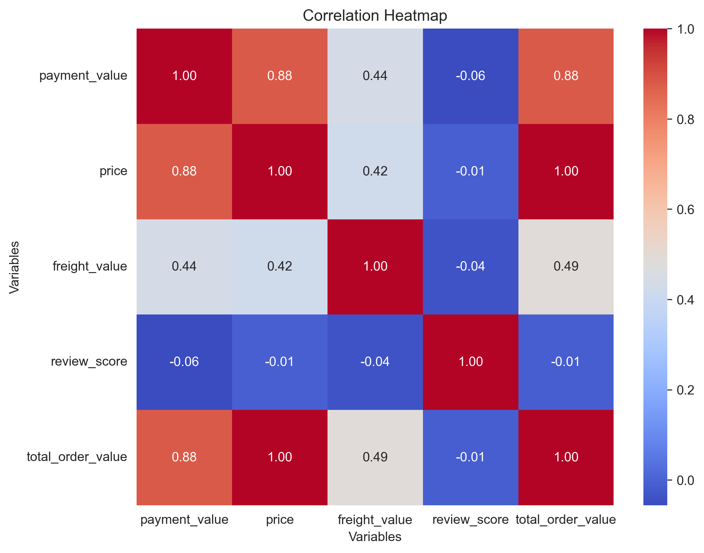
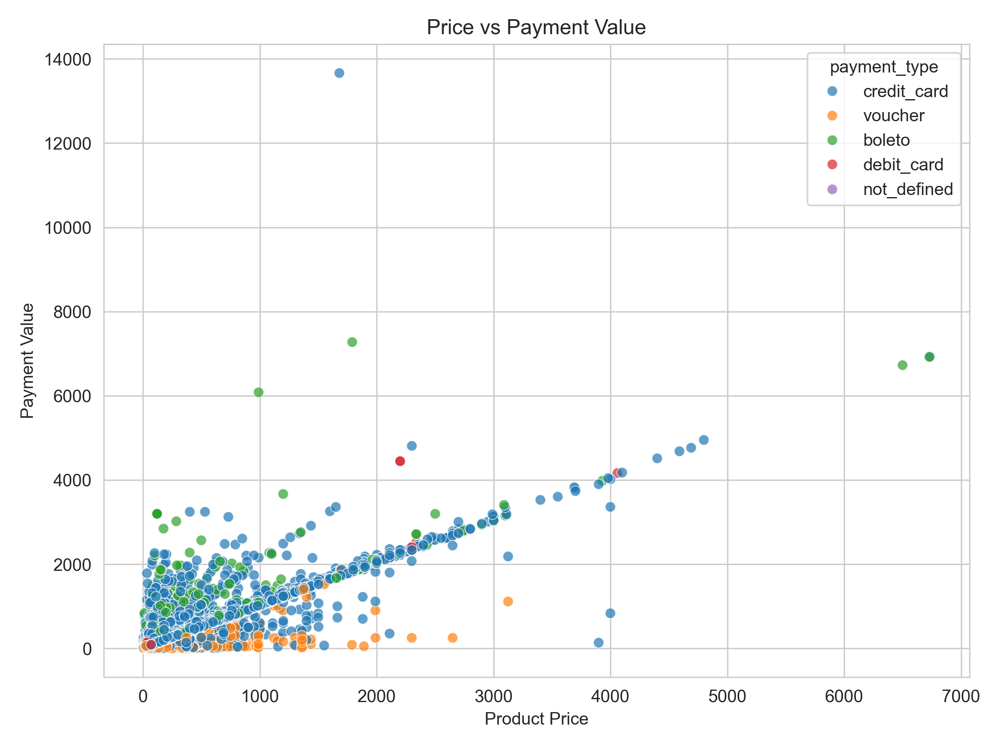
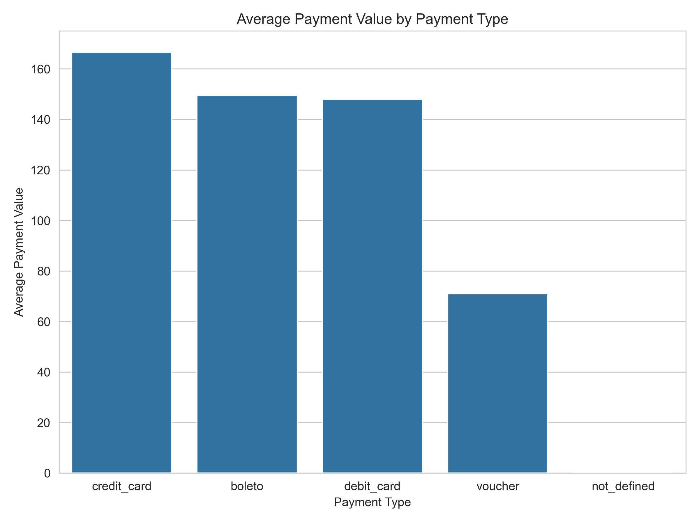
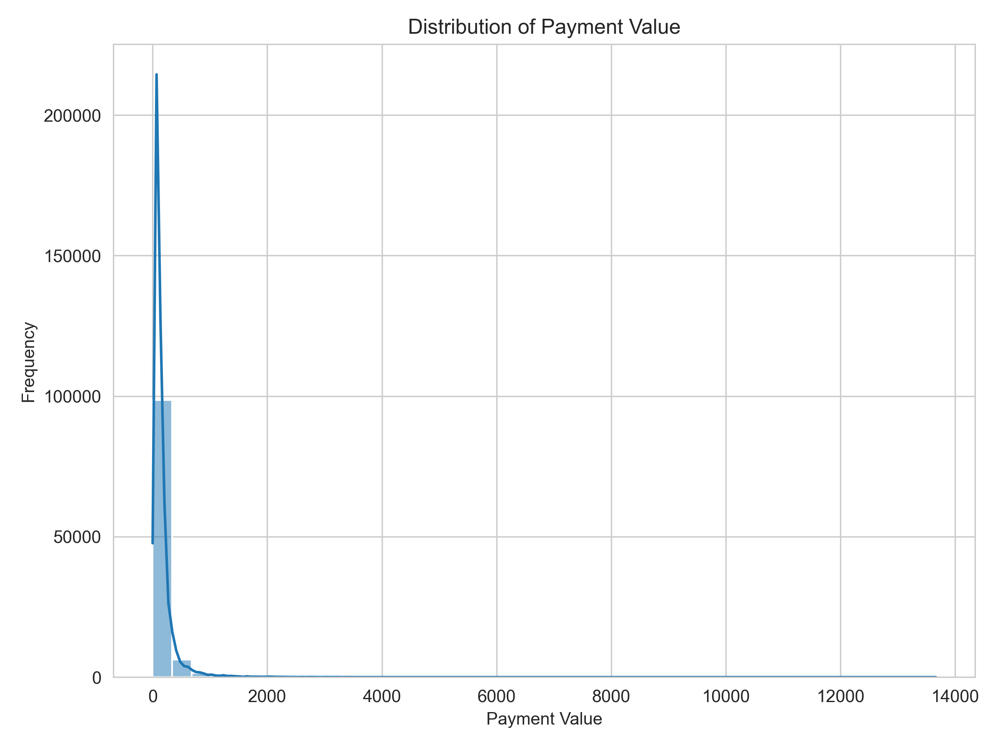

# 📊 Statistical EDA, Hypothesis Testing & Visualization

> **Data Analytics with Gen & Agentic AI – Capstone Project (Part 2)**

**Student Name:** Bhuvaneswari Yennapusala

---

# 📖 Project Overview

Statistical analysis is one of the most important stages in the data analytics lifecycle because it transforms raw data into meaningful business insights. This project demonstrates a complete statistical analysis workflow using the **Olist Brazilian E-Commerce Dataset**, beginning with data preparation and progressing through exploratory data analysis, descriptive statistics, feature engineering, correlation analysis, hypothesis testing, and visualization.

The implementation was developed entirely in Python using industry-standard data analysis libraries. Each stage of the analysis is organized into separate Python modules, making the project modular, maintainable, and easy to reproduce.

This repository satisfies all the requirements specified for **Part 2 – Statistical EDA, Hypothesis Testing & Visualization** of the **Data Analytics with Gen & Agentic AI Capstone Project**.

---

# 🎯 Project Objectives

The objectives of this project are to:

- Perform statistical exploratory data analysis on a real-world e-commerce dataset.
- Understand customer purchasing behaviour using descriptive statistics.
- Apply NumPy for efficient numerical computation.
- Create meaningful business features through feature engineering.
- Compare business metrics using grouped analysis.
- Measure relationships among numerical variables using Pearson Correlation.
- Validate a business claim using statistical hypothesis testing.
- Present findings using informative visualizations.
- Generate actionable business recommendations supported by statistical evidence.

---

# 📂 Dataset Information

### Dataset Used

**Olist Brazilian E-Commerce Dataset**

**Source**

https://www.kaggle.com/datasets/olistbr/brazilian-ecommerce

The original dataset consists of multiple relational CSV files representing customers, orders, products, payments, and reviews.

For this project, these datasets were merged into a single processed dataset suitable for statistical analysis.

---

### Processed Dataset Summary

| Property | Value |
|-----------|------:|
| Total Records | 107,447 |
| Total Columns | 13 |
| Date Column | order_purchase_timestamp |
| Dataset Type | Structured Tabular Dataset |

The processed dataset exceeds the assignment requirements of having at least **500 rows**, **6 columns**, and **one date column**.

---

# 💻 Technologies Used

| Category | Technology |
|-----------|------------|
| Programming Language | Python |
| Data Analysis | Pandas |
| Numerical Computing | NumPy |
| Statistical Analysis | SciPy |
| Visualization | Matplotlib, Seaborn |
| IDE | Visual Studio Code |
| Version Control | Git & GitHub |

---

# 📁 Repository Structure

```text
Statistical-EDA-Hypothesis-Visualization/

│
├── README.md
├── LICENSE
├── requirements.txt
├── .gitignore
│
├── data/
│   └── raw/
│       ├── olist_customers_dataset.csv
│       ├── olist_order_items_dataset.csv
│       ├── olist_order_payments_dataset.csv
│       ├── olist_order_reviews_dataset.csv
│       ├── olist_orders_dataset.csv
│       └── olist_products_dataset.csv
│
├── python/
│   ├── config.py
│   ├── create_dataset.py
│   ├── eda_analysis.py
│   ├── correlation_analysis.py
│   ├── hypothesis_testing.py
│   └── visualizations.py
│
├── output/
│   ├── processed_dataset.csv
│   └── correlation_matrix.csv
│
└── images/
    ├── correlation_heatmap.png
    ├── scatter_plot.png
    ├── bar_plot.png
    └── distribution_plot.png
```

---

# ⚙ Project Execution Workflow

The project has been divided into multiple modules, with each Python file responsible for a specific stage of the statistical analysis pipeline.

| Python Script | Purpose |
|--------------|---------|
| **config.py** | Stores project paths and configuration settings used across all modules. |
| **create_dataset.py** | Loads the raw CSV files, merges the required datasets, removes duplicate records, inspects missing values, and creates the processed dataset used throughout the project. |
| **eda_analysis.py** | Performs exploratory data analysis including dataset inspection, NumPy operations, descriptive statistics, feature engineering, grouped analysis, and bucket segmentation. |
| **correlation_analysis.py** | Computes the Pearson Correlation Matrix, identifies the highest and lowest correlation pairs, and exports the correlation matrix. |
| **hypothesis_testing.py** | Performs statistical hypothesis testing using Welch's Independent Two-Sample t-test and reports the statistical decision. |
| **visualizations.py** | Generates and saves all required visualizations in PNG format. |

---


# Requirements

- **Python:** 3.12+
- **Libraries:** pandas, numpy, scipy, matplotlib, seaborn

```bash
pip install -r requirements.txt
```

# ▶ How to Run the Project

Clone the repository

```bash
git clone <your-github-repository-link>
```

Move into the project directory

```bash
cd Statistical-EDA-Hypothesis-Visualization
```

Install all required libraries

```bash
pip install -r requirements.txt
```

Execute the project in the following order.

### Step 1 — Dataset Preparation

```bash
python python/create_dataset.py
```

### Step 2 — Exploratory Data Analysis

```bash
python python/eda_analysis.py
```

### Step 3 — Correlation Analysis

```bash
python python/correlation_analysis.py
```

### Step 4 — Hypothesis Testing

```bash
python python/hypothesis_testing.py
```

### Step 5 — Generate Visualizations

```bash
python python/visualizations.py
```

---

# 📝 Implementation Details

The implementation has been organized according to the tasks specified in the project instructions. Each task builds upon the previous one, forming a complete statistical analysis workflow.

The following sections describe each task, the implementation approach, the output generated, and the corresponding Python script responsible for that stage.


# Task 1 – Initial Inspection

## Objective

The first step of the analysis was to understand the structure and quality of the processed dataset before performing any statistical computations. This inspection helps identify the number of observations, data types, missing values, and the overall characteristics of the dataset.

---

## Implementation

The processed dataset generated during the data preparation stage was loaded into a Pandas DataFrame.

The following inspection methods were executed:

- `df.info()`
- `df.describe(include='all')`

These methods were used to:

- Verify the total number of rows and columns.
- Check the data type of each attribute.
- Identify missing values.
- Understand numerical and categorical features.
- Confirm that the dataset satisfies the project requirements.

During inspection, the dataset contained:

- **107,447 records**
- **13 columns**
- Numerical, categorical, and datetime attributes

The inspection also revealed missing values in attributes such as:

- Product Category
- Product Price
- Freight Value
- Review Score

These observations helped ensure that later statistical computations handled missing values appropriately.

---

## Output Produced

The following information was printed to the console:

- Dataset Shape
- Data Types
- Non-null Count
- Memory Usage
- Statistical Summary
- Missing Value Information

---

## Python Script

```
python/eda_analysis.py
```

---

# Task 2 – NumPy Fundamentals

## Objective

The objective of this task was to demonstrate efficient numerical computation using NumPy by converting dataset columns into NumPy arrays and performing vectorized operations.

---

## Implementation

The **payment_value** column was converted into a NumPy ndarray using the `to_numpy()` method.

```python
payment_array = df["payment_value"].to_numpy()
```

Instead of using Python loops, a vectorized arithmetic operation was applied to increase every payment value by **10%**.

```python
updated_payment = payment_array * 1.10
```

Boolean indexing was then used to retrieve only the transactions whose payment values were between **100** and **500**.

```python
(payment_array > 100) &
(payment_array < 500)
```

This demonstrates NumPy's ability to process entire arrays efficiently while producing concise and readable code.

---

## Output Produced

The script displays:

- First ten payment values
- Updated payment values after the vectorized operation
- Filtered payment values satisfying both conditions

---

## Python Script

```
python/eda_analysis.py
```

---

# Task 3 – Descriptive Statistics

## Objective

The purpose of this task was to summarize important numerical variables using statistical measures that describe the central tendency and variability of the data.

---

## Implementation

Two numerical attributes were selected:

- Payment Value
- Freight Value

For each attribute, the following statistical measures were calculated using NumPy.

- Mean
- Median
- Variance
- Standard Deviation
- 90th Percentile

These statistics help understand customer payment behaviour and shipping cost distribution.

For example:

- Mean Payment Value ≈ **158.31**
- Median Payment Value ≈ **102.87**
- Mean Freight Value ≈ **20.15**

The difference between the mean and median indicates that payment values are positively skewed, with some high-value transactions increasing the average.

---

## Output Produced

The calculated statistics for both numerical columns are displayed in the terminal.

---

## Python Script

```
python/eda_analysis.py
```

---

# Task 4 – Feature Engineering

## Objective

Feature engineering was performed to create a new business metric that better represents the complete financial value of an order.

---

## Implementation

A new feature named **total_order_value** was created by combining product price and freight cost.

Formula used:

```python
total_order_value = price + freight_value
```

This derived feature represents the total amount associated with an order and is used throughout the remaining analysis.

The newly created column was added directly to the DataFrame and previewed to verify correctness.

---

## Output Produced

The dataset preview displays:

- Price
- Freight Value
- Total Order Value

confirming that the new feature was successfully created.

---

## Python Script

```
python/eda_analysis.py
```

---

# Task 5 – Grouped Analysis

## Objective

After creating the new business feature, the next objective was to understand customer purchasing behaviour across different categories. Grouped analysis helps summarize large datasets by calculating aggregate statistics for specific groups, making it easier to identify patterns and trends.

---

## Implementation

Three different grouped analyses were performed using Pandas.

### 1. Pivot Table – Payment Type Analysis

The first pivot table calculates the **average payment value** for each payment method.

Grouping Column:

```
payment_type
```

Aggregation Function:

```
Mean
```

This analysis helps compare the average transaction value across different payment methods such as Credit Card, Boleto, Voucher, and Debit Card.

---

### 2. Pivot Table – Customer State Analysis

The second pivot table calculates the **average total order value** for each customer state.

Grouping Column:

```
customer_state
```

Aggregation Function:

```
Mean
```

This comparison provides insight into geographical purchasing behaviour and identifies states with higher average order values.

---

### 3. Multi-Aggregation Analysis

To obtain more detailed statistical summaries, a **multi-aggregation GroupBy** operation was performed.

The following aggregation functions were calculated simultaneously.

For **payment_value**

- Mean
- Maximum

For **freight_value**

- Mean
- Sum

Using multiple aggregation functions provides a more comprehensive understanding of payment behaviour and shipping costs across payment methods.

---

## Output Produced

The script prints:

- Pivot Table 1
- Pivot Table 2
- Multi-Aggregation GroupBy Summary

These summaries provide meaningful comparisons between customer groups and payment methods.

---

## Python Script

```
python/eda_analysis.py
```

---

# Task 6 – Bucket Segmentation

## Objective

Customer segmentation is an important analytical technique used to divide continuous numerical values into meaningful business categories. This enables easier comparison of customer behaviour across different spending levels.

---

## Implementation

A custom Python function named **order_bucket()** was created to categorize orders based on their **total_order_value**.

Three spending categories were defined.

| Order Value | Category |
|-------------|----------|
| Less than 100 | Low |
| 100 – 299 | Medium |
| 300 and above | High |

The function was applied to every record using

```python
.apply()
```

A new categorical column named

```
order_category
```

was added to the dataset.

The updated DataFrame was displayed to verify that the new categories were assigned correctly.

---

## Output Produced

The script displays:

- Bucket Distribution
- Number of records in each category
- Updated DataFrame preview containing the new column

This segmentation enables future analyses based on customer spending categories.

---

## Python Script

```
python/eda_analysis.py
```

---

# Task 7 – Correlation Analysis

## Objective

Correlation analysis was performed to measure the strength and direction of relationships among all numerical variables in the dataset.

Understanding these relationships helps identify which business metrics influence each other and which variables are largely independent.

---

## Implementation

The Pearson Correlation Matrix was computed for all numerical columns using Pandas.

The following variables were included in the analysis.

- payment_value
- price
- freight_value
- review_score
- total_order_value

The correlation matrix was exported as

```
output/correlation_matrix.csv
```

for future reference.

---

### Highest Correlation

The strongest relationship observed was between

**Price** and **Total Order Value**

Correlation Coefficient

```
0.9973
```

This extremely strong positive correlation is expected because the total order value is calculated using the product price along with freight charges.

---

### Lowest Correlation

The weakest relationship observed was between

**Payment Value** and **Review Score**

Correlation Coefficient

```
-0.0559
```

The correlation is very close to zero, indicating almost no linear relationship between the amount spent by customers and the ratings they provide.

---

### Handling Special Cases

To ensure accurate reporting, the following rules were applied.

**Diagonal Values**

Self-correlations were excluded because every variable has a correlation of **1.0** with itself.

---

**NaN Values**

Any undefined correlation values caused by missing or constant data were replaced with **0** before identifying the highest and lowest correlation pairs.

---

**Tie Handling**

If multiple variable pairs shared the same correlation value, the first pair returned by Pandas was selected and reported.

---

## Output Produced

The script generates:

- Pearson Correlation Matrix
- Highest Correlation Pair
- Lowest Correlation Pair
- Correlation Matrix CSV file

---

## Python Script

```
python/correlation_analysis.py
```

---

### Transition to the Next Stage

After understanding the statistical relationships among variables, the next step is to validate a business claim using statistical hypothesis testing. This determines whether the observed differences between customer groups are statistically significant or occurred by chance.

---

# Task 8 – Business Hypothesis

## Objective

After completing the exploratory data analysis and correlation analysis, the next step was to statistically validate a business assumption. Instead of relying only on descriptive statistics, hypothesis testing was performed to determine whether the observed difference between two customer payment groups was statistically significant.

---

## Business Problem

Different payment methods may influence the amount customers spend during a transaction. Understanding this behaviour can help businesses design targeted payment offers, discounts, and promotional campaigns.

To investigate this, the following business claim was tested.

> **Business Claim:** The average payment value differs between customers who use **Credit Card** and those who use **Boleto** as their payment method.

---

## Statistical Hypotheses

### Null Hypothesis (H₀)

There is **no statistically significant difference** in the average payment value between Credit Card and Boleto transactions.

Mathematically,

```
H₀ : μCredit Card = μBoleto
```

---

### Alternative Hypothesis (H₁)

There **is a statistically significant difference** in the average payment value between Credit Card and Boleto transactions.

Mathematically,

```
H₁ : μCredit Card ≠ μBoleto
```

---

## Significance Level

The significance level selected for this analysis was

```
α = 0.05
```

A p-value less than 0.05 indicates sufficient statistical evidence to reject the null hypothesis.

---

## Why This Test Was Selected

The analysis compares the mean payment values of **two independent customer groups**:

- Credit Card Transactions
- Boleto Transactions

Since these groups are independent and may not have equal variances, the **Welch Independent Two-Sample t-test** was selected.

Welch's t-test is more robust than the standard Student's t-test when group variances differ.

---

## Python Script

```
python/hypothesis_testing.py
```

---

# Task 9 – Statistical Hypothesis Testing

## Objective

The objective of this task was to evaluate the business claim using statistical evidence rather than assumptions.

The hypothesis test was performed using the **SciPy** statistical library.

---

## Information

The following customer groups were compared.

| Payment Method | Sample Size |
|---|---:|
| Credit Card | 79,939 |
| Boleto | 20,514 |

The large sample sizes increase the reliability of the statistical analysis.

---

## Business Claim

The business claim tested was:

> **The average payment value differs between Credit Card and Boleto transactions.**

The purpose of the test was to determine whether the observed difference in average payment values between the two payment methods is statistically significant.

---

## Hypotheses

### Null Hypothesis (H₀)

There is no difference in the average payment value between Credit Card and Boleto transactions.

```text
H₀: μ_credit_card = μ_boleto
```

---

### Alternative Hypothesis (H₁)

There is a difference in the average payment value between Credit Card and Boleto transactions.

```text
H₁: μ_credit_card ≠ μ_boleto
```

The hypothesis test was conducted at a **5% significance level**.

```text
α = 0.05
```

---

## Assumptions Considered

Before performing the hypothesis test, the following assumptions were reviewed.

### Independent Observations

Each transaction in the dataset represents an independent customer order.

The Credit Card and Boleto transactions were treated as two independent groups for the purpose of the statistical comparison.

---

### Sample Size

Both payment groups contain a sufficiently large number of observations:

- **Credit Card:** 79,939
- **Boleto:** 20,514

The large sample sizes increase the reliability of the statistical analysis and make the comparison of group means more robust.

---

### Approximate Normality

The distribution of payment values was reviewed using the distribution plot generated during the EDA.

The payment values show some skewness. However, both groups have very large sample sizes, so the sampling distribution of the mean is expected to be approximately normal under the **Central Limit Theorem**.

Therefore, the two-sample t-test was considered appropriate for comparing the group means.

---

### Equal Variance

Equal variance was **not assumed**.

Therefore, `equal_var=False` was used while performing Welch's Independent Two-Sample t-test.

Welch's t-test is appropriate when comparing the means of two independent groups without requiring the assumption that their population variances are equal.

---

## Test Used

Since the analysis compares the average payment values of two independent groups and equal variance was not assumed, **Welch's Independent Two-Sample t-test** was selected.

The test was performed using SciPy:

```python
from scipy.stats import ttest_ind

statistic, p_value = ttest_ind(
    credit_card_values,
    boleto_values,
    equal_var=False
)
```

---

## Test Results

The statistical analysis produced the following results.

| Metric | Value |
|---|---|
| Test Used | Welch Independent Two-Sample t-test |
| Test Statistic | **9.9021** |
| P-value | **< 0.000001** |
| Significance Level | **0.05** |

---

## Decision

The decision rule used was:

```text
If P-value < α:
    Reject H₀

If P-value ≥ α:
    Fail to reject H₀

``` 

In this analysis:

P-value < 0.000001
α = 0.05

Therefore:

P-value < α

### Decision: **Reject H₀**

The Null Hypothesis was rejected because the p-value is smaller than the chosen significance level of 0.05.

---

## Interpretation

The analysis provides strong statistical evidence that the average payment value differs significantly between Credit Card and Boleto transactions.

This suggests that customer spending behaviour varies depending on the selected payment method.

The result indicates that the observed difference in average payment values between the two groups is statistically significant and unlikely to be explained by random sampling variation alone.

Such information can be valuable for designing **payment-specific marketing strategies and promotional campaigns**.

> **Note:** Statistical significance indicates evidence of a difference between the group means; it does not by itself establish that the payment method causes the difference.

---

## Output Produced

The script displays:

- Business Claim
- Null Hypothesis
- Alternative Hypothesis
- Significance Level
- Sample Sizes
- Test Used
- Test Statistic
- P-value
- Statistical Decision
- Assumptions Checked
- Interpretation

---

## Python Script

python/hypothesis_testing.py

---


# Task 10 – Data Visualization

## Objective

Visualizations were created to transform statistical findings into easily interpretable graphical representations.

Each visualization highlights a different aspect of customer purchasing behaviour and supports the statistical analysis performed in previous tasks.

All figures were generated automatically using **Matplotlib** and **Seaborn** and saved in PNG format.

---

## Correlation Heatmap

The correlation heatmap displays the Pearson correlation coefficients between all numerical variables.

This visualization helps quickly identify both strong and weak relationships among business metrics.

Output File

```
images/correlation_heatmap.png
```

---

## Scatter Plot

The scatter plot illustrates the relationship between **Payment Value** and **Total Order Value**.

Different payment methods are represented using different colours through the **hue** parameter.

This chart helps visualize transaction patterns across payment methods.

Output File

```
images/scatter_plot.png
```

---

## Bar Plot

The bar plot compares the average order value across customer categories.

Aggregated values make it easier to compare overall business performance between groups.

Output File

```
images/bar_plot.png
```

---

## Distribution Plot

The histogram illustrates the distribution of customer payment values.

This visualization provides insight into the spread, concentration, and skewness of transaction amounts.

Output File

```
images/distribution_plot.png
```

---

## Chart Standards

Every visualization includes

- Appropriate title
- X-axis label
- Y-axis label
- Automatic PNG export using

```python
plt.savefig()
```

---

## Python Script

```
python/visualizations.py
```

---

# Transition to Final Analysis

The statistical analysis, hypothesis testing, and visualizations collectively provide quantitative evidence about customer purchasing behaviour.

The final stage of the project focuses on converting these findings into meaningful business insights and practical recommendations for decision-making.

---

# Task 11 – Business Insights and Recommendations

The statistical analysis performed throughout this project provides several valuable insights into customer purchasing behaviour. These findings can assist businesses in making informed decisions regarding pricing strategies, payment options, and customer engagement.

---

## Insight 1 – Product Price Strongly Influences Total Order Value

### Observation

The Pearson Correlation Analysis identified the strongest relationship between **Price** and **Total Order Value**, with a correlation coefficient of:

```
0.9973
```

This extremely high positive correlation indicates that changes in product price have a direct and substantial impact on the overall order value.

### Business Recommendation

Businesses should regularly review pricing strategies for high-value products. Since product price is the primary contributor to total order value, optimizing pricing and promoting premium products can significantly improve overall revenue.

---

## Insight 2 – Customer Spending Varies by Payment Method

### Observation

The hypothesis test comparing **Credit Card** and **Boleto** transactions produced the following results:

| Metric | Value |
|---------|-------|
| Test Statistic | **9.9021** |
| P-value | **< 0.000001** |

Since the p-value is significantly smaller than **0.05**, the null hypothesis was rejected.

This confirms that customer spending differs significantly between these two payment methods.

### Business Recommendation

Businesses should design payment-specific promotional campaigns. For example, cashback offers, reward points, or installment options for Credit Card users may encourage higher-value purchases.

---

## Insight 3 – Customer Ratings Are Not Strongly Related to Spending

### Observation

The weakest correlation identified during the analysis was between **Payment Value** and **Review Score**.

Correlation Coefficient:

```
-0.0559
```

This value is very close to zero, indicating almost no linear relationship between the amount customers spend and the ratings they provide.

### Business Recommendation

Improving customer satisfaction should focus on factors such as product quality, delivery speed, customer support, and overall shopping experience rather than assuming that higher spending leads to better reviews.

---

# Project Outputs

The project automatically generates the following output files.

## Processed Dataset

```
output/
└── processed_dataset.csv
```

---

## Correlation Matrix

```
output/
└── correlation_matrix.csv
```

---

## Generated Visualizations

```
images/

├── correlation_heatmap.png
├── scatter_plot.png
├── bar_plot.png
└── distribution_plot.png
```

These visualizations are generated automatically during project execution and saved in PNG format.

---


# Generated Visualizations

The project automatically generates four statistical visualizations. These figures summarize the relationships and distributions identified during the analysis.

## 1. Correlation Heatmap

The correlation heatmap illustrates the Pearson correlation coefficients between all numerical variables in the dataset, making it easy to identify strong positive and negative relationships.



---

## 2. Scatter Plot

The scatter plot visualizes the relationship between **Payment Value** and **Total Order Value**, with different payment methods distinguished using the `hue` parameter.



---

## 3. Bar Plot

The bar plot compares the aggregated average order value across different customer categories, providing an overview of purchasing behaviour.



---

## 4. Distribution Plot

The distribution plot shows how customer payment values are distributed, helping identify skewness, spread, and concentration of transaction amounts.




# Challenges Encountered

During development, several practical challenges were addressed:

- Combining multiple relational CSV files into a single analytical dataset while preserving data consistency.
- Handling duplicate records and missing values before performing statistical analysis.
- Organizing the project into modular Python scripts to improve maintainability and readability.
- Ensuring that each statistical method matched the assignment requirements.
- Creating visualizations that clearly communicated statistical findings while meeting formatting requirements.

Addressing these challenges resulted in a structured, reproducible, and maintainable analytics workflow.

---

# Future Enhancements

This project can be extended in several ways:

- Perform time-series analysis to identify seasonal purchasing trends.
- Build predictive machine learning models for customer spending behaviour.
- Develop an interactive dashboard using Streamlit or Power BI.
- Perform customer segmentation using clustering algorithms.
- Automate report generation for business stakeholders.
- Integrate real-time e-commerce transaction data for continuous analysis.

---

# Conclusion

This project demonstrates a complete statistical data analysis workflow using a real-world e-commerce dataset. Beginning with data preparation and exploratory analysis, the project applies descriptive statistics, feature engineering, grouped analysis, Pearson correlation, statistical hypothesis testing, and data visualization to generate meaningful business insights.

The analysis revealed strong relationships between pricing variables, statistically significant differences in customer payment behaviour, and practical opportunities for improving pricing strategies and payment-specific marketing initiatives.

By combining statistical techniques with clear visual communication, the project provides a reproducible analytical workflow that supports data-driven decision-making while fulfilling all the requirements of the **Data Analytics with Gen & Agentic AI – Capstone Project (Part 2)**.

---

# Author

**Bhuvaneswari Yennapusala**

**Course:** Data Analytics with Gen & Agentic AI X Masai

**Capstone Project – Part 2**

---

