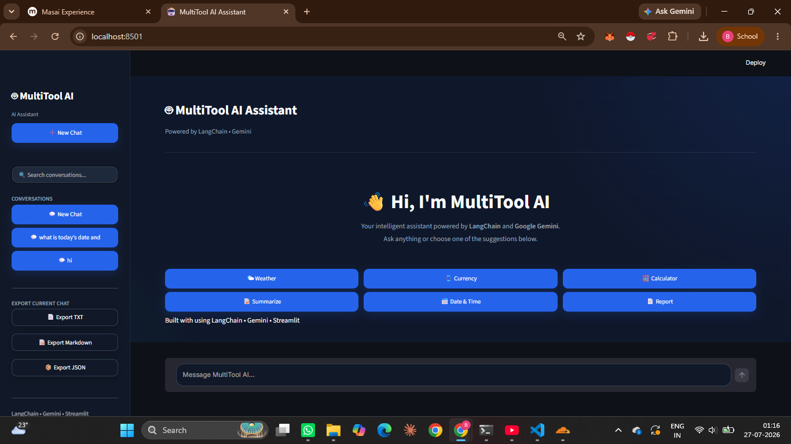
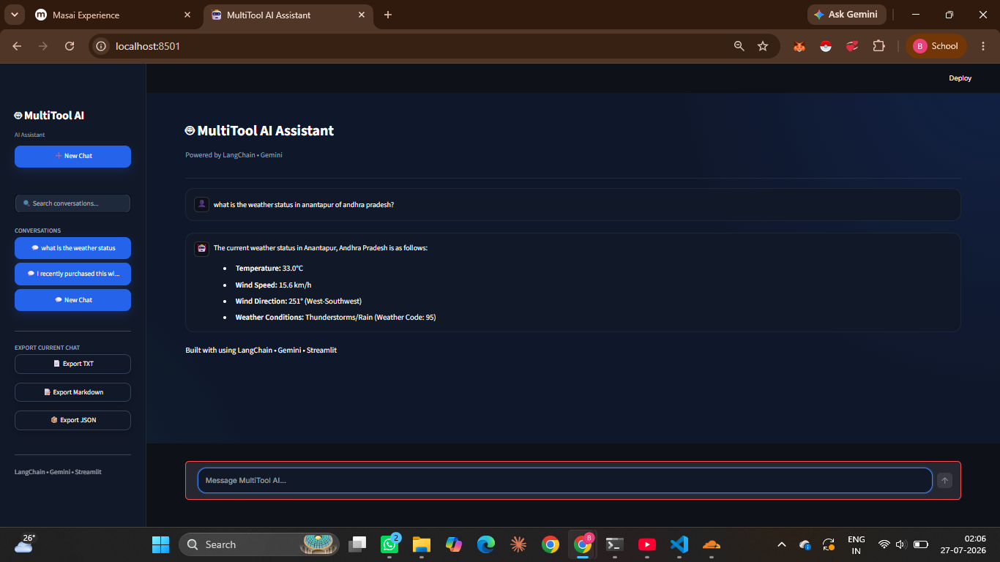
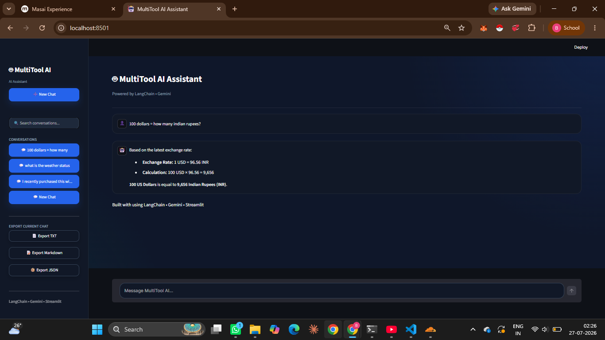
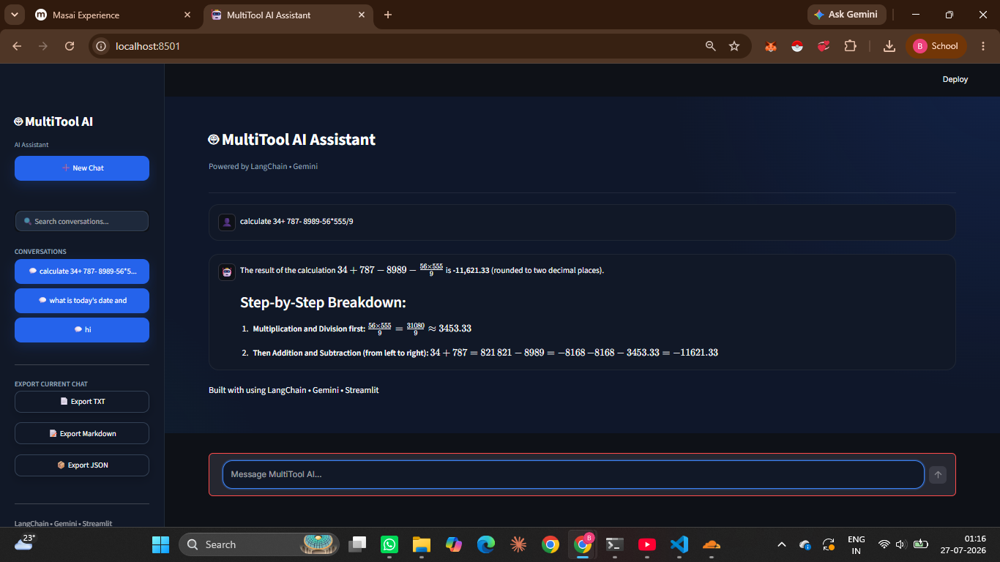
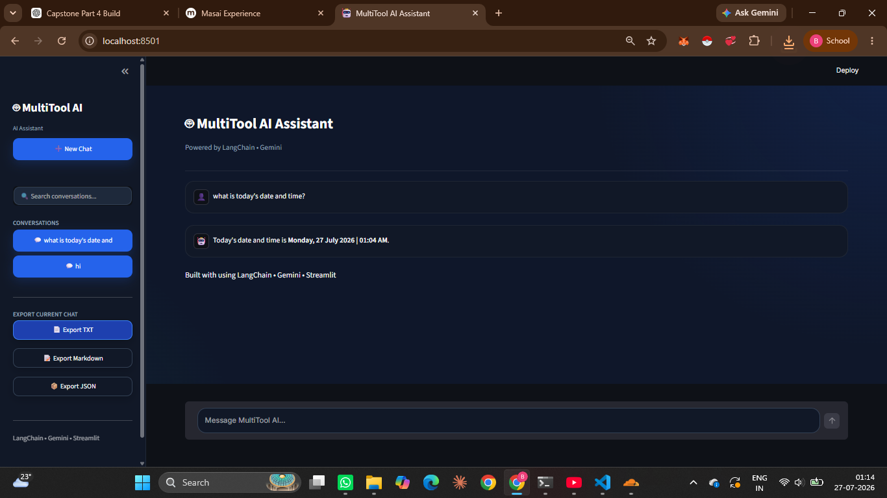
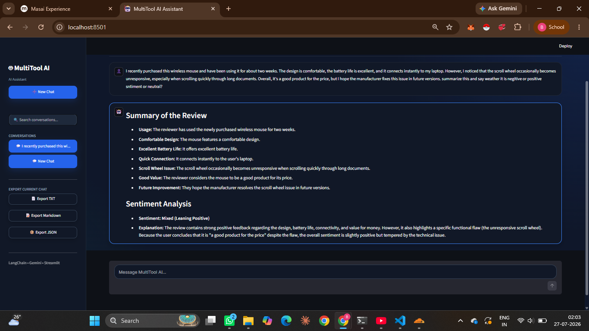
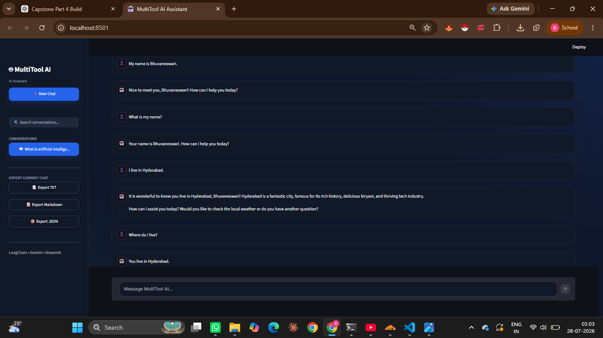
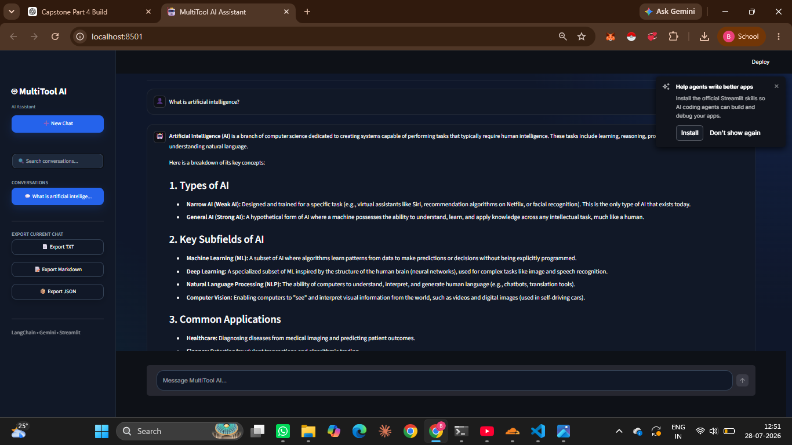
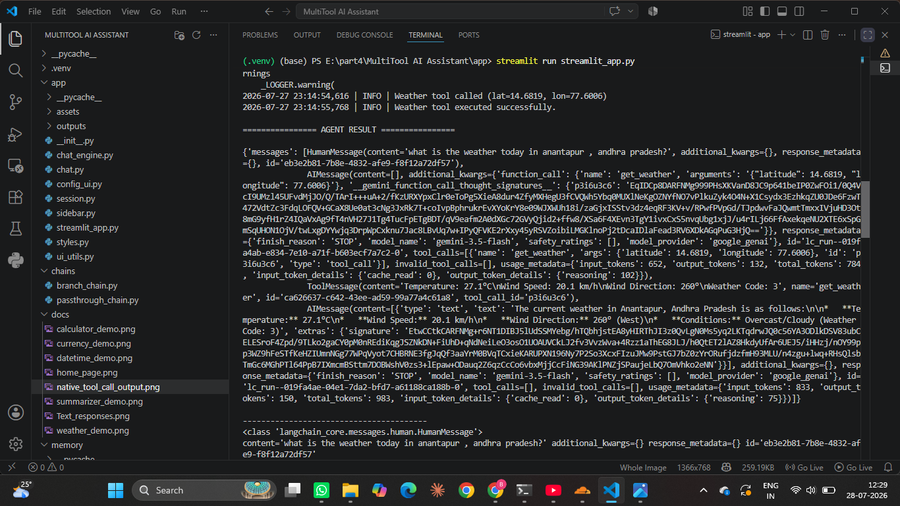
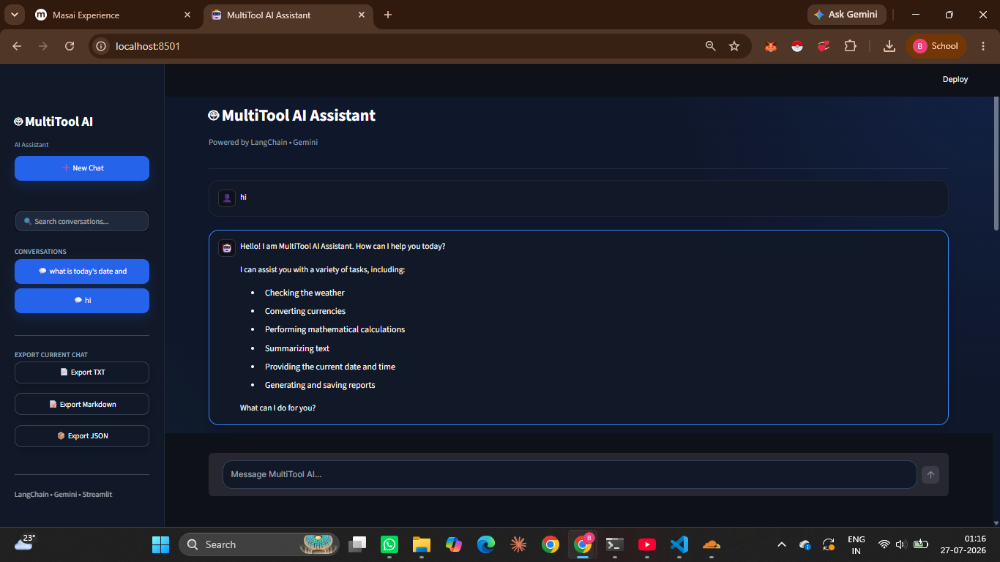

# MultiTool AI Assistant

A multi-tool AI assistant built with **LangChain, Google Gemini and Streamlit**.

This project was developed for **Part 4 – Generative & Agentic AI** of the Masai School Data Analytics Capstone Project.

The main part of the project is a **single autonomous LangChain agent** that can choose from multiple registered tools based on the user's query. The project also includes an LCEL workflow for conditional routing, conversation memory, external API tools, and a Streamlit interface.

## Project Option

**Option A – LangChain Single Autonomous Agent**

The main agent is created with LangChain and Google Gemini. The tools are registered with the agent and the model decides when a tool is required.

---

## Objectives

- Build a single autonomous LangChain agent.
- Integrate Google Gemini with LangChain.
- Register multiple tools with the agent.
- Use native LangChain tool calling.
- Use structured tool arguments.
- Integrate external APIs.
- Demonstrate LCEL conditional routing.
- Use `RunnablePassthrough` and `RunnablePassthrough.assign()`.
- Use `RunnableBranch` for routing.
- Maintain conversation context using memory.
- Include a write-capable report tool.
- Handle tool and API errors.
- Limit agent execution with `ModelCallLimitMiddleware`.
- Provide a Streamlit interface.
- Test the agent, tools, chains and memory.

---

## Features

### Autonomous Agent

The main agent uses LangChain's `create_agent()` API. The user can ask a question directly and the agent decides whether one of the registered tools should be used.

### Six Tools

The agent currently has six tools:

1. Weather
2. Currency conversion
3. Calculator
4. Current date and time
5. Text summarization
6. Report generation

### Native Tool Calling

The agent uses LangChain's native tool-calling mechanism. The test script shows the selected tool, arguments, tool-call ID, tool result and final response.

### LCEL Workflow

The project contains a separate LCEL workflow using:

- `RunnablePassthrough`
- `RunnablePassthrough.assign()`
- `RunnableLambda`
- `RunnableBranch`
- `ChatPromptTemplate`
- `StrOutputParser`

### Conversation Memory

Conversation memory is included for maintaining context during a conversation.

### External APIs

- Open-Meteo is used for weather information.
- Frankfurter is used for currency exchange rates.
- Google Gemini is used by the agent and summarization functionality.

### Report Generation

The report tool accepts a title and content and saves the generated report as a local file.

### Bounded Agent Execution

The agent uses `ModelCallLimitMiddleware` with:

```python
MAX_ITERATIONS = 5
```

This limits model calls during one agent run.

---

## Technology Stack

| Technology | Purpose |
|---|---|
| Python | Main programming language |
| LangChain | Agent and tool orchestration |
| Google Gemini | Language model |
| LCEL | Conditional workflow |
| Streamlit | User interface |
| Open-Meteo | Weather API |
| Frankfurter | Currency API |
| python-dotenv | Environment variables |
| requests | API requests |
| Git / GitHub | Version control |

---

## Architecture

The main application flow is:

```text
                         User
                           |
                           v
                  Streamlit Interface
                           |
                           v
                    LangChain Agent
                           |
                 +---------+---------+
                 |                   |
                 v                   v
           Google Gemini       Registered Tools
                                     |
                  +------------------+------------------+
                  |        |        |        |         |
                  v        v        v        v         v
               Weather  Currency Calculator Date/Time Summary
                                                            |
                                                            v
                                                     Report Generator
```

For a tool-based query:

```text
User Query
    |
    v
LangChain Agent
    |
    v
Google Gemini
    |
    v
Native Tool Call
    |
    +---- Tool name
    |
    +---- Tool arguments
    |
    v
Tool execution
    |
    v
Tool result
    |
    v
Google Gemini
    |
    v
Final answer
```

---

## Agent Implementation

The main agent is implemented in:

```text
agent.py
```

The Gemini model is initialized with `ChatGoogleGenerativeAI`.

The registered tools are:

```python
TOOLS = [
    get_weather,
    get_exchange_rate,
    calculate,
    summarize_text,
    get_current_datetime,
    save_report,
]
```

The agent is created using LangChain's `create_agent()`.

The system prompt instructs the agent to use the appropriate tool when required and not to invent results for tool-based requests.

---

## Tools

| Tool | Function | Input | Purpose |
|---|---|---|---|
| Weather | `get_weather` | `latitude`, `longitude` | Get weather information |
| Currency | `get_exchange_rate` | `base`, `target` | Get exchange-rate information |
| Calculator | `calculate` | `expression` | Calculate an expression |
| Date & Time | `get_current_datetime` | None | Get current date and time |
| Summarizer | `summarize_text` | `text` | Summarize text using Gemini |
| Report Generator | `save_report` | `title`, `content` | Save a generated report |

The report generator is the write-capable tool because it creates a local file.

---

## Native Tool Calling

The project uses LangChain's native tool-calling mechanism instead of manually selecting tools from the model's text response.

The flow is:

```text
User Query
    ↓
Model
    ↓
tool_calls
    ↓
Tool name + arguments + tool-call ID
    ↓
Tool execution
    ↓
Tool result
    ↓
Model
    ↓
Final answer
```

`test_agent.py` prints the native tool-call information.

### Calculator

Query:

```text
What is 50 * 120?
```

Tool:

```text
calculate
```

Arguments:

```python
{'expression': '50 * 120'}
```

Tool result:

```text
6000
```

Final answer:

```text
The result of 50 * 120 is 6,000.
```

### Date and Time

Query:

```text
What is today's date and time?
```

Tool:

```text
get_current_datetime
```

Arguments:

```python
{}
```

The tool returns the current date and time, which is then used by the agent to generate the final response.

### Currency

Query:

```text
Convert USD to INR.
```

Tool:

```text
get_exchange_rate
```

Arguments:

```python
{
    'target': 'INR',
    'base': 'USD'
}
```

Tool result from the test:

```text
1 USD = 95.3 INR
```

Final answer:

```text
The current exchange rate is 1 USD = 95.30 INR.
```

These examples show the complete sequence:

```text
Query
  ↓
Tool selection
  ↓
Arguments
  ↓
Tool execution
  ↓
Tool result
  ↓
Final answer
```

---

## LCEL Conditional Workflow

The LCEL workflow is implemented in:

```text
chains/branch_chain.py
```

It demonstrates state creation, state enrichment and conditional routing.

The main components are:

```text
RunnablePassthrough
RunnablePassthrough.assign()
RunnableLambda
RunnableBranch
ChatPromptTemplate
StrOutputParser
```

### Workflow

```text
User Query
    |
    v
RunnablePassthrough
    |
    v
Question State
    |
    v
RunnablePassthrough.assign()
    |
    v
Enriched State
    |
    v
RunnableBranch
    |
    +---- greeting ----> Greeting Chain
    |
    +---- general -----> Gemini LLM Chain
```

### Greeting Route

Input:

```text
hello
```

Workflow state:

```python
{
    "question": "hello",
    "category": "greeting"
}
```

Selected route:

```text
greeting
```

### General Route

Input:

```text
Explain artificial intelligence
```

Workflow state:

```python
{
    "question": "Explain artificial intelligence",
    "category": "general"
}
```

Selected route:

```text
general
```

The general query is passed to the Gemini LLM chain.

### LCEL Test

Run:

```powershell
python test_branch.py
```

The test prints the question, workflow state, selected route and final result.

---

## RunnablePassthrough

The project contains:

```text
chains/passthrough_chain.py
```

This demonstrates `RunnablePassthrough` in an LCEL chain.

The branch workflow uses:

```python
RunnablePassthrough.assign()
```

to add the query category to the workflow state.

---

## Conversation Memory

Conversation memory is implemented in:

```text
memory/conversation_memory.py
```

The project also contains:

```text
memory.py
```

The memory implementation is tested using:

```powershell
python test_memory.py
```

The purpose of the memory component is to preserve relevant context from earlier messages during a conversation.

---

## External APIs

### Weather

File:

```text
tools/weather_tool.py
```

Uses Open-Meteo for weather information.

### Currency

File:

```text
tools/currency_tool.py
```

Uses Frankfurter for exchange-rate information.

### Google Gemini

Gemini is used by the main agent and by the text summarization functionality.

---

## Text Summarization

The summarization tool is:

```text
tools/text_summarizer_tool.py
```

It accepts text and uses Gemini to generate a summary.

During development, a `429 RESOURCE_EXHAUSTED` error was encountered after reaching the available Gemini free-tier request quota. The tool handles the error and returns a readable response instead of stopping the complete application.

---

## Report Generation

The report tool is:

```text
tools/report_tool.py
```

It accepts:

```text
title
content
```

and saves the generated report as a local file.

The title is sanitized before the filename is created.

This is the write-capable tool in the current tool set.

---

## Error Handling

The project includes error handling for tool and API failures, including:

- Weather API failures
- Currency API failures
- Invalid calculator expressions
- Gemini quota/rate-limit errors
- Summarization failures
- Report-writing failures

Where possible, the tools return readable error messages instead of terminating the complete application.

---

## Bounded Agent Execution

The project uses:

```python
ModelCallLimitMiddleware
```

The configuration contains:

```python
MAX_ITERATIONS = 5
```

The middleware is configured as:

```python
iteration_limit_middleware = ModelCallLimitMiddleware(
    run_limit=MAX_ITERATIONS,
    exit_behavior="end",
)
```

It is passed to the agent:

```python
agent = create_agent(
    model=model,
    tools=TOOLS,
    system_prompt=SYSTEM_PROMPT,
    middleware=[
        iteration_limit_middleware,
    ],
)
```

This provides a fixed limit on model calls during an agent run.

---

## Streamlit Application

The Streamlit entry point is:

```text
app/streamlit_app.py
```

The `app` package also contains modules for chat handling, session handling, sidebar configuration, styles and UI helpers.

Start the application with:

```powershell
streamlit run app/streamlit_app.py
```

---

## Project Structure

```text
MultiTool-AI-Assistant/
│
├── app/
│   ├── __init__.py
│   ├── chat.py
│   ├── chat_engine.py
│   ├── config_ui.py
│   ├── session.py
│   ├── sidebar.py
│   ├── streamlit_app.py
│   ├── styles.py
│   └── ui_utils.py
│
├── chains/
│   ├── branch_chain.py
│   └── passthrough_chain.py
│
├── docs/
│   ├── Text_responses.png
│   ├── calculator_demo.png
│   ├── conversation_memory_demo.png
│   ├── currency_demo.png
│   ├── datetime_demo.png
│   ├── home_page.png
│   ├── native_tool_call_execution.png
│   ├── runnablebranch_greeting.png
│   ├── runnablebranch_llm.png
│   ├── summarizer_demo.png
│   └── weather_demo.png
│
├── memory/
│   ├── __init__.py
│   └── conversation_memory.py
│
├── tools/
│   ├── calculator_tool.py
│   ├── currency_tool.py
│   ├── datetime_tool.py
│   ├── report_tool.py
│   ├── text_summarizer_tool.py
│   └── weather_tool.py
│
├── utils/
│   ├── helpers.py
│   └── logger.py
│
├── agent.py
├── config.py
├── list_models.py
├── memory.py
├── requirements.txt
├── LICENSE
├── README.md
│
├── test_agent.py
├── test_branch.py
├── test_calculator.py
├── test_chat_engine.py
├── test_currency.py
├── test_datetime.py
├── test_gemini.py
├── test_helpers.py
├── test_logger.py
├── test_memory.py
├── test_passthrough.py
├── test_report.py
├── test_summarizer.py
└── test_weather.py
```

---

## Configuration

Create a `.env` file in the project root:

```env
GOOGLE_API_KEY=your_google_api_key
```

The project uses `python-dotenv` to load the API key.

Do not commit the `.env` file or expose the API key in source code.

Important configuration values include:

```python
MODEL_NAME = "gemini-3.5-flash"
TEMPERATURE = 0.2
MAX_ITERATIONS = 5
```

---

## Complete Setup

### 1. Clone the repository

```powershell
git clone https://github.com/iameshureddy/MultiTool-AI-Assistant.git
cd MultiTool-AI-Assistant
```

### 2. Create a virtual environment

```powershell
python -m venv .venv
```

Activate it:

```powershell
.venv\Scripts\activate
```

### 3. Upgrade pip

```powershell
python -m pip install --upgrade pip
```

### 4. Install dependencies

```powershell
pip install -r requirements.txt
```

### 5. Configure Gemini

Create `.env`:

```env
GOOGLE_API_KEY=your_google_api_key
```

---

## How to Run

After setup, the following commands can be used to verify and run the project.

### Check Gemini integration

```powershell
python -c "from langchain_google_genai import ChatGoogleGenerativeAI; print('Gemini integration available')"
```

### Check the agent

```powershell
python -c "from agent import agent; print('Agent imported successfully')"
```

Expected:

```text
Agent imported successfully
```

### Test native tool calling

```powershell
python test_agent.py
```

### Test the LCEL workflow

```powershell
python test_branch.py
```

### Test memory

```powershell
python test_memory.py
```

### Test the passthrough chain

```powershell
python test_passthrough.py
```

### Start Streamlit

```powershell
streamlit run app/streamlit_app.py
```

Open the local URL shown by Streamlit in your browser.

A typical address is:

```text
http://localhost:8501
```

To stop the application:

```text
Ctrl + C
```

---

## Example Queries

Try these after starting the application:

### Greeting

```text
Hello
```

### Calculator

```text
What is 50 * 120?
```

### Date and Time

```text
What is today's date and time?
```

### Currency

```text
Convert USD to INR.
```

### Weather

```text
What is the weather at latitude 17.3850 and longitude 78.4867?
```

### General Question

```text
Explain artificial intelligence.
```

### Summarization

```text
Summarize this text:
Artificial Intelligence is changing healthcare, education and finance by
automating repetitive tasks and improving decision making.
```

### Report

```text
Generate a report about Artificial Intelligence in Healthcare.
```

---

## Testing

The repository contains separate test files for the agent, tools, chains, memory and utility modules.

### Agent

```powershell
python test_agent.py
```

Tests the autonomous agent and native tool-call trace.

### LCEL Branch

```powershell
python test_branch.py
```

Tests the stateful conditional workflow.

### Calculator

```powershell
python test_calculator.py
```

### Currency

```powershell
python test_currency.py
```

### Date & Time

```powershell
python test_datetime.py
```

### Gemini

```powershell
python test_gemini.py
```

### Memory

```powershell
python test_memory.py
```

### Passthrough

```powershell
python test_passthrough.py
```

### Report

```powershell
python test_report.py
```

### Summarizer

```powershell
python test_summarizer.py
```

### Weather

```powershell
python test_weather.py
```

Additional tests are available for the chat engine, helper functions and logger:

```text
test_chat_engine.py
test_helpers.py
test_logger.py
```

---

## Syntax Checks

Run:

```powershell
python -m py_compile agent.py
python -m py_compile config.py
python -m py_compile chains/branch_chain.py
python -m py_compile chains/passthrough_chain.py
python -m py_compile test_agent.py
python -m py_compile test_branch.py
```

No output from these commands indicates that the files passed the syntax check.

---

## Screenshots

The repository contains screenshots of the application and important test results.

### Home Page



### Weather



### Currency



### Calculator



### Date and Time



### Summarizer



### Conversation Memory



### RunnableBranch Greeting


### RunnableBranch LLM Route



### Native Tool Calling



### Text Responses



---

## Development Challenges

### Gemini API quota

A `429 RESOURCE_EXHAUSTED` error was encountered during summarization testing after reaching the available Gemini request quota. The summarizer handles the exception and returns a readable message.

### LCEL routing

The branch workflow was changed to use workflow state with `RunnablePassthrough.assign()` and `RunnableBranch`.

### Tool-call verification

The agent test was extended to show the native tool name, arguments, tool-call ID and tool result instead of only displaying the final answer.

### Agent execution limit

`ModelCallLimitMiddleware` was added to give an agent run a fixed model-call limit.

---

## Current Implementation

| Component | Implementation |
|---|---|
| Autonomous agent | `agent.py` |
| Gemini | `ChatGoogleGenerativeAI` |
| Registered tools | 6 |
| Native tool calling | LangChain agent |
| Weather API | Open-Meteo |
| Currency API | Frankfurter |
| Calculator | `calculator_tool.py` |
| Date & Time | `datetime_tool.py` |
| Summarization | `text_summarizer_tool.py` |
| Report/write tool | `report_tool.py` |
| LCEL | `chains/` |
| RunnablePassthrough | `passthrough_chain.py` |
| RunnablePassthrough.assign() | `branch_chain.py` |
| RunnableBranch | `branch_chain.py` |
| Conversation memory | `memory/` |
| Agent execution limit | `ModelCallLimitMiddleware` |
| UI | Streamlit |
| Tests | Multiple test scripts |
| Screenshots | `docs/` |


## Author

**Bhuvaneswari Yennapusala**

Data Analytics with Generative & Agentic AI  
Masai School
